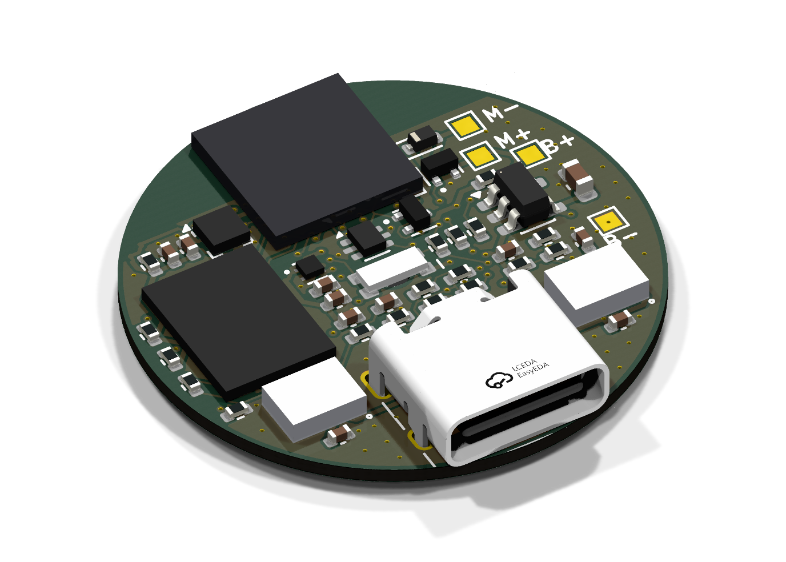
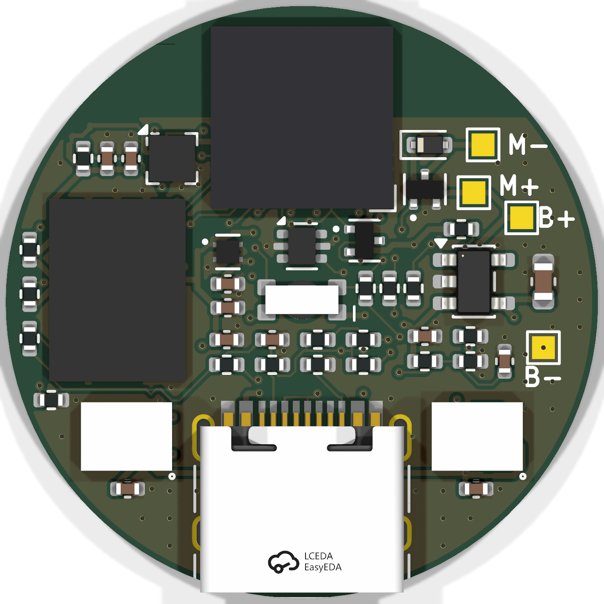
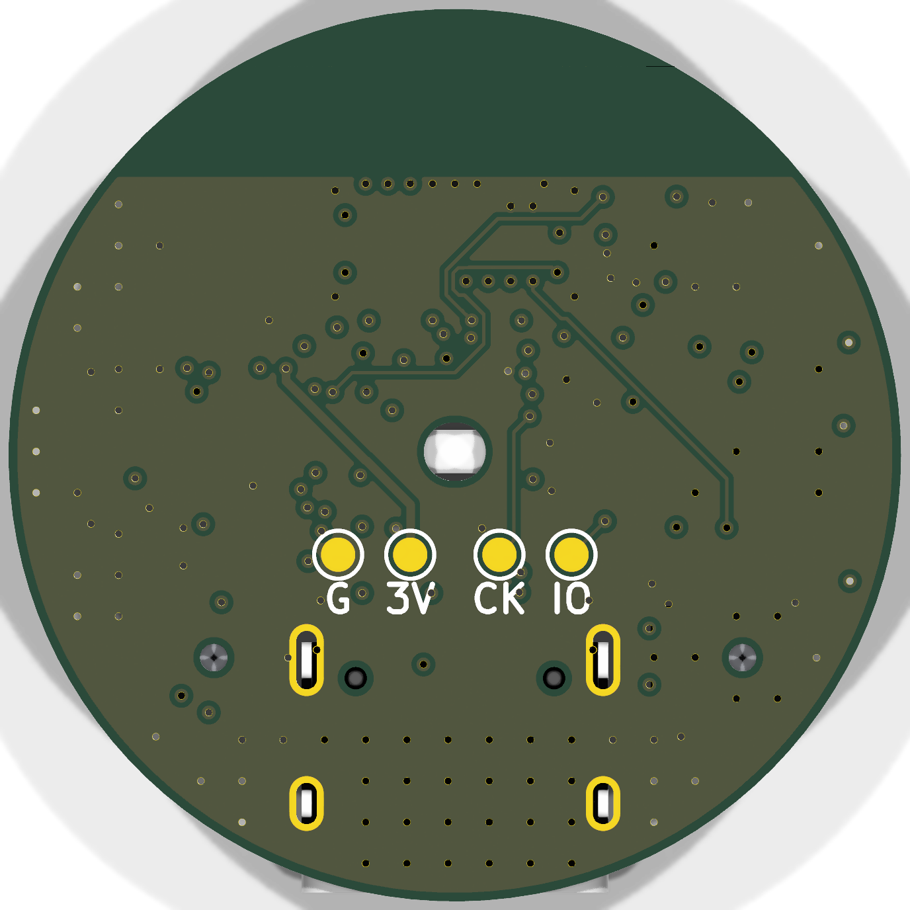
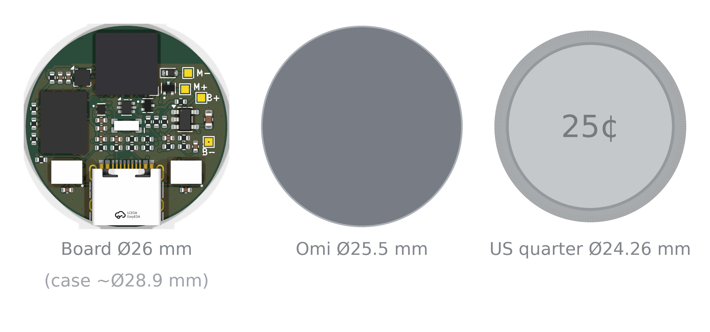

# OhMyOmi

A DIY approach to building your own [Omi](https://www.omi.me) wearable for less than the cost of buying one. It is a small round pendant that records your conversations with two MEMS microphones, saves them to on-board flash and syncs to your phone over Bluetooth later, or streams live. The whole board is generated from Python scripts, autorouted with Freerouting and ready to order from JLCPCB with assembly.



| Parts side *(faces into the case)* | Front face *(against the case front)* |
| :---: | :---: |
|  |  |



## Board

- Ø26 mm round, 6 layers, 0.8 mm thick, ENIG
- Every assembled part on one side *(JLCPCB Economic PCBA)*. The blank side sits flat against the inside of the case front.
- Mics listen through 0.8 mm holes in the board and the RGB LED shines through a slot, so no light pipe is needed
- Pendant size with a case is about Ø28.9 x 12.3 mm

| Part                | What it does                                                 |
|---------------------|--------------------------------------------------------------|
| ISP1807-LR-RS       | nRF52840 Bluetooth module with built-in antenna and crystals |
| 2x IM73D122V01      | Infineon PDM microphones, 73 dB SNR, stereo on one bus       |
| MKDV4GCL-ABB        | 512 MB SLC SD NAND over SPI, power switched by a P-MOSFET    |
| LIS2DW12            | Accelerometer for tap controls and motion wake               |
| MCP73832            | LiPo charger, 66 mA                                          |
| TPS7A0233           | 3.3 V LDO, 25 nA quiescent                                   |
| USBLC6-2P6          | ESD protection on USB                                        |
| HRO TYPE-C-31-M-12  | USB-C for charging and USB data                              |
| MHT151RGBCT         | Reverse mount RGB LED                                        |
| DMG1012T + RB521S30 | Vibration motor driver                                       |

The battery is a 150 mAh CP1654 cell with wire leads soldered to the B+ and B- pads. A coin vibration motor solders to M+ and M-. Four test pads on the front face carry SWDIO, SWDCLK, 3V3 and GND for programming.

## Ordering

Upload these from `pcb/jlcpcb/` to JLCPCB:

- `omi-gerbers.zip` for the board
- `omi-bom.csv` and `omi-cpl.csv` for assembly

Check the part rotations in the JLCPCB placement preview before paying, especially LED1, both mics, U4, U5, U6, Q1, Q2, D1 and J1. Cost for 5 boards with 2 assembled is about $120 before shipping, the battery and the motor. The ISP1807 comes through JLCPCB Global Sourcing.

## Firmware notes

The firmware is not written yet. The board depends on these settings:

- PDM clock 1.280 MHz with ratio 80 *(16 kHz)*. The nRF default of 1.032 MHz falls between the mic's power modes and will not work.
- Stereo PDM, MK1 on the falling edge and MK2 on the rising edge
- LED pins P0.13, P0.17 and P0.14 in high drive mode
- Drive P0.30 low to power the SD NAND, and float its SPI pins before turning it off
- Charge status on P0.31 *(low while charging)*
- Battery voltage on AIN4 through a 1M/1M divider, TACQ 40 us
- Enable the nRF DC/DC *(DCDCEN)*
- Compress audio before saving *(Opus)*. Raw 16 kHz stereo fills 512 MB in about 2 hours.
- Use a watchdog. There is no reset button.

## Building

Needs KiCad 9 *(pcbnew Python and kicad-cli)* and Flask for the preview.

```
cd pcb
python3 gen_lib.py                         # footprints, symbols, schematic
python3 build_pcb.py place                 # unrouted board with zones and keepouts
cp omi.kicad_pcb omi_unrouted.kicad_pcb
./flow.sh                                  # autoroute, import, pours, fixups, DRC
./rebuild.sh                               # redo pours, fixups and DRC on the last route without re-routing
python3 outputs.py                         # gerbers, BOM, CPL, renders, 3D model
python3 compare.py                         # size comparison render
python3 summary.py                         # prices, stock and cost for the preview
```

`flow.sh` runs Freerouting 2.5.0 from `tools/` with its own Java 25 runtime, inside `sudo unshare -n` so it has no network access. `tools/` is not tracked. Put `freerouting-2.5.0.jar` and a Java 25 JRE back there to re-route.

## Previews

- `pcb/preview/app.py` serves the board preview *(layers, cost, parts, 3D view at `/3d`)* on port 20005
- `app.py` serves the original dev-board wiring preview on port 20004
